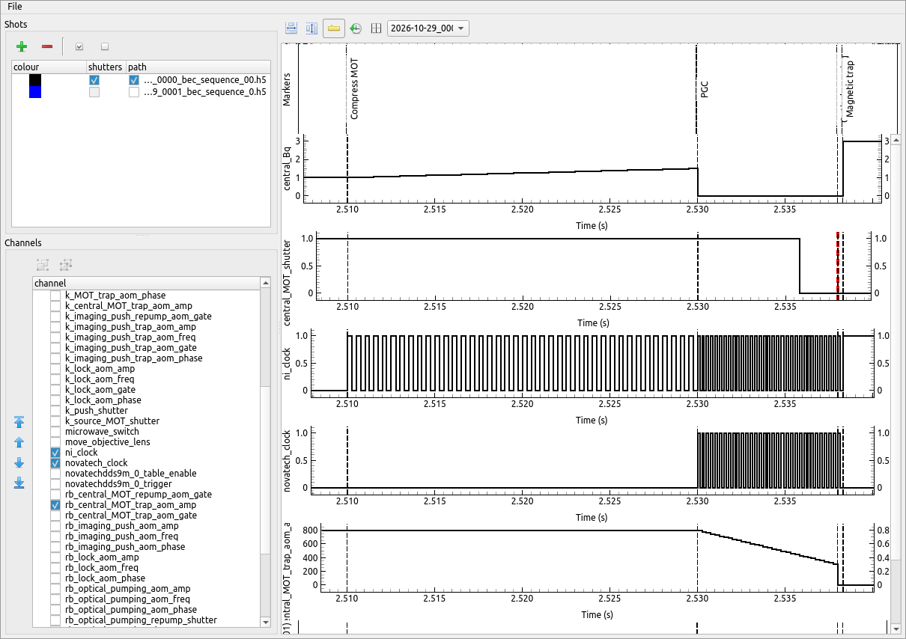

Introduction
============

Runviewer is used for viewing, graphically, the expected changes in each output across one
or more shots, and is shown in :numref:`fig-interface`. Its use is optional, but can be extremely useful for
debugging the behaviour of experiment logic. The output traces are generated directly from
the set of hardware instructions stored in a given hdf5 file. This provides a faithful representation
of what the hardware will actually do. In effect, runviewer provides a low level
representation of the experiment, which complements the high level representation provided
by the experiment logic written using the labscript API. As such, runviewer traces provide
a way to view the quantisation of outputs, [2]_ which can be seen in the `central_Bq` and
`rb_central_MOT_trap_aom_amp` channels in :numref:`fig-interface`. You can also view the
pseudoclock outputs. The `ni_clock` and `novatech_clock` channels show the independent
clocking of devices from a single PulseBlaster pseudoclock: the NI cards are clocked at the
sample rates of the two analog ramps, and the NovaTech DDS9m at the 1 kHz sample rate of a
frequency ramp that starts at the 'PGC' marker.

.. _fig-interface:

    The runviewer interface, zoomed in on the compression of a MOT and the start of an
    optical molasses (PGC) stage. The analog outputs `central_Bq` and
    `rb_central_MOT_trap_aom_amp` are ramped in steps of 0.5 ms and 0.25 ms.

.. rubric:: Footnotes

.. [1] Documentation taken from Starkey, Phillip T. *A software framework for control and automation of precisely timed experiments*
    PhD Thesis, Monash University (2019) https://doi.org/10.26180/5d1db8ffe29ef

.. [2] While this is always true in time, the output values may not be correctly quantised if the labscript
    device implementation does not quantise the output values correctly and instead relies on BLACS, 
    the device programming API or the device firmware, to correctly quantise the output values.