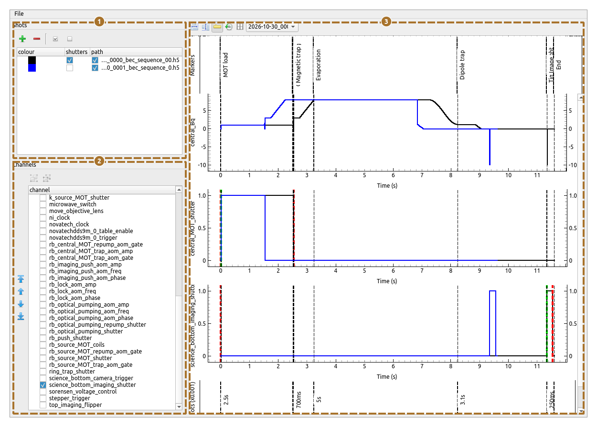
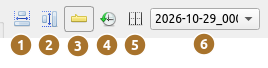
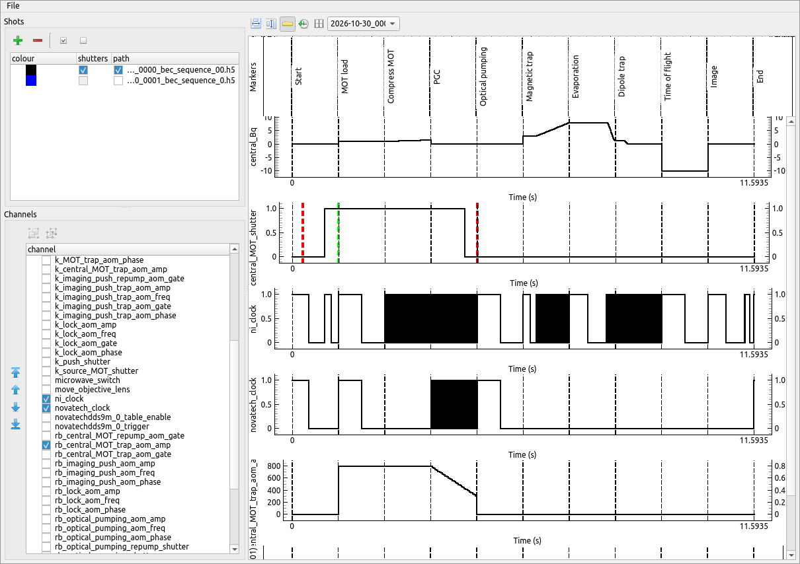
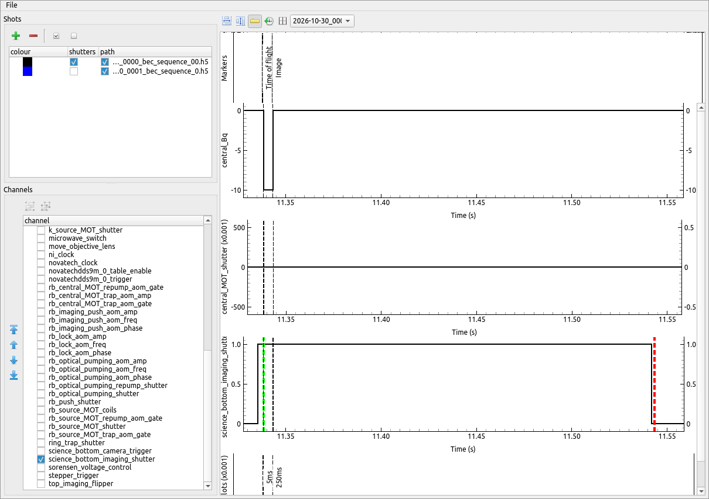

Usage
=====

An experiment script written with labscript defines the experiment logic in ‘high level’
terms, and there can be a discrepancy between what was intended and what was actually
commanded. This is particularly likely when more complex control flow features (such as
while loops or parameterised functions) are used. Runviewer shows what was commanded, as a
series of plots of the output state of each channel. These plots are ‘reverse-engineered’
from the hardware instructions stored in the hdf5 file, and are thus a faithful
representation of what each output channel should do during an experiment, provided that
the device code that reconstructs them is correct.

There are several uses for runviewer. The most important is the ability to graphically
observe the experiment logic. This allows a user to easily observe experiment features
such as the shape of complex ramps or the synchronisation between events on different
channels. Runviewer also supports simultaneous display of traces from multiple shots providing,
for example, a means to see how an output trace changes when a global variable is
adjusted. Finally, comparisons between expected output in runviewer, and observed output
on an oscilloscope can make debugging hardware problems quicker.

Generating output traces
------------------------

Runviewer generates the displayed output traces by processing the hardware instructions
stored in the hdf5 shot file, which are the lowest level description of the experiment
logic. Part of the reconstruction is done by device specific code, a runviewer parser,
that is written for each device when support for it is added to
:doc:`labscript-devices <labscript-devices:index>`. The parser simulates how the device
processes hardware instructions and updates output states. The reconstruction algorithm is
as follows:

#. Runviewer reads the name of the master pseudoclock device from the HDF5 file.
#. Runviewer imports the runviewer parser of the master pseudoclock and requests that it
   generate the traces of its outputs. Nothing controls the timing of the master
   pseudoclock, so runviewer passes no clock trace to its parser.
#. | The parser generates a set of output traces and passes each of them to runviewer by
     calling a function that runviewer provides, which makes the trace available for
     display. A parser can produce any number of traces, of any output type.
   |
   | If runviewer passes a clock trace to the parser (which it does for all devices except
     the master pseudoclock, see step 5 below), the parser uses it to generate the correct
     timing of the output traces. For example, a Novatech DDS9m only stores a table of
     output state changes, so the parser needs the timing information of the parent
     ClockLine. Similarly, the timing of a secondary pseudoclock depends on state changes
     of the parent Trigger.
#. The parser then returns to runviewer a dictionary of the traces of the ClockLines and
   Triggers of the device (which may also have been passed to runviewer for display in the
   previous step).
#. For each ClockLine or Trigger in this dictionary, runviewer finds the devices that are
   its children. For each such device, runviewer imports its parser and calls it as in
   step 2, but with the trace of the ClockLine or Trigger, so that the parser can generate
   output traces with the correct timing. Runviewer repeats steps 3 to 5 recursively until
   all devices have been processed.

The graphical interface
-----------------------

The graphical interface of runviewer comprises 3 sections (see :numref:`fig-overview`). The first section
manages the loading of shots into runviewer. Here you can enable (or disable) shots for
plotting, choose the plot colour, and choose whether markers for shutter open and close
times should be displayed. The second section manages the channels that are to be plotted.
These channels can be reordered using the controls to the left, which then affects the order
in which the plots appear. The list displays the union of all channels of the shots that
are enabled or have been enabled. A channel that is not in any enabled shot stays in the
list, disabled, with its check box unchanged, and is plotted again when a shot that has the
channel is enabled. The order of the channels and their check boxes can also be saved to a
file and loaded from it with the ‘File’ menu.

.. _fig-overview:

    The runviewer interface consists of 3 main sections. (1) Controls for loading
    shots, selecting the colour of traces, selecting whether shutter open/close markers are to
    be shown, and whether the output traces from this shot should be shown. Shutter markers
    are shown for only one of the two shots loaded (the black trace). (2) A reorderable list
    of channels contained within the loaded shots. The order here determines the order of
    plots in (3). Only enabled channels will be displayed in (3). (3) Plots of the output
    traces for the selected channels in the selected shots, with the time markers of the
    first shot above and below them. The two shots differ in the length of the MOT loading
    stage and in whether the magnetic trap is decompressed before the dipole trap is loaded.
    In this figure the entire length of the trace is displayed, which makes it difficult to
    distinguish between the shutter open/close events (green and red dashed, vertical lines)
    and the digital output trace. The discrepancy between these events becomes more apparent
    when zooming in (see :numref:`fig-detail`).

The third section comprises the plotting region. Runviewer draws the plots with the
Python plotting library :doc:`pyqtgraph <pyqtgraph:index>`. The user can pan and zoom the
plots using the mouse (by holding the left or right mouse button respectively while moving
the mouse).
The time axes of each plot are linked together so that multiple output traces can be easily
compared to each other. Above the plots are six controls (see :numref:`fig-controls`):

#. *Show all time* sets the time axis of the plots to the whole duration of the enabled
   shots.
#. *Autoscale y-axis* sets the vertical axis of each plot to the range of its traces.
#. When the tooltip button is checked, a tooltip shows the channel, the time and the value
   of the trace under the mouse pointer.
#. *Reset time axis* makes the time axis linear again after the markers have been moved
   or spaced evenly.
#. *Space markers evenly* makes the intervals between consecutive time markers equally wide
   on the time axis, so that short stages of the experiment take up as much of the plot
   as long ones (see :numref:`fig-markers`).
#. The drop-down list selects the shot whose time markers are drawn.

.. _fig-controls:

    The controls above the plots, numbered as in the list above.

The time markers of a shot are the times given to :func:`add_time_marker
<labscript.labscript.add_time_marker>` in the experiment script, and the start and the end of the
shot. They are drawn as vertical dashed lines on every plot, in the colours given to
`add_time_marker`. The plot above the channels shows the label of each marker, and the plot
below the channels shows the duration of the interval that follows each marker. Dragging
a marker in the plot of the labels moves it along the time axis and stretches or
compresses the intervals on either side of it, which makes the time axis non-linear. The
markers are spaced evenly in :numref:`fig-markers`.

.. _fig-markers:

    The shot of :numref:`fig-interface` with its time markers spaced evenly. The stages of
    the MOT compression, the optical molasses and the optical pumping, which last 20 ms,
    8 ms and 0.3 ms, are as wide on the time axis as the 2.5 s of the MOT loading.

The output traces are generated directly from the hardware instructions. This creates two
problems: information about the timing of certain events may not be contained within the
hardware instructions, and the output trace may contain too many data points to plot
efficiently. Runviewer solves the first problem by plotting vertical markers at points of
interest. For example, the Shutter class
automatically accounts for the open and close delay of a shutter. The output trace thus
only captures the time at which the digital output goes high or low and does not capture
when the shutter will be open or closed. Runviewer reverse engineers these missing times
from metadata stored within the hdf5 so that they can be plotted as markers
of interest (see :numref:`fig-detail`).

.. _fig-detail:

    The traces of :numref:`fig-overview`, zoomed in on the absorption image at the end of the
    first shot. The digital output of `science_bottom_imaging_shutter` (black trace) changes
    state before the times at which the shutter is commanded to be open and closed (green and
    red dashed, vertical lines). The shutter (open, close) delay is specified in the
    experiment script as (3.16, 1.74) ms.

The second problem is solved by resampling the output traces to the visible range of the
time axis whenever that range changes. The resampling function,
`labscript_c_extensions.runviewer.resample`, preserves features that are faster than the
sampling interval, which many down-sampling algorithms miss. It fills an output array of
3 × 2000 + 2 points, evenly spaced over the visible range of the time axis. The value of
every third point is the value of the trace at that time ('nearest neighbour on the
left' interpolation). The two points that follow it have the highest and the lowest
values of the trace in the time interval that the three points span, in the order in which
they occur in the trace. Fast features are thus represented by three points of the array, which pyqtgraph
plots in one pixel as a vertical line. This is similar to the way digital oscilloscopes
display acquired signals.

The resampling runs in a pool of threads, so that the GUI stays responsive. When the user
zooms in, the plot shows the previously resampled trace, which has more points than the
plot has pixels, until the resampling of the new range is complete.
